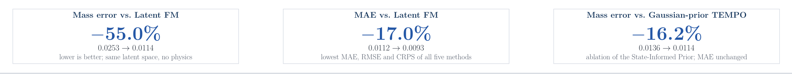
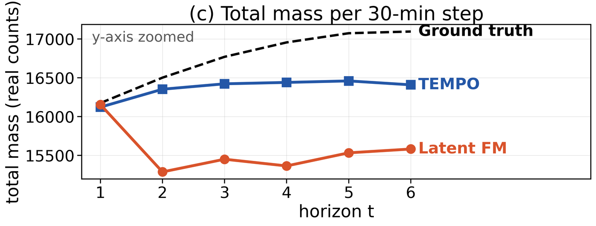
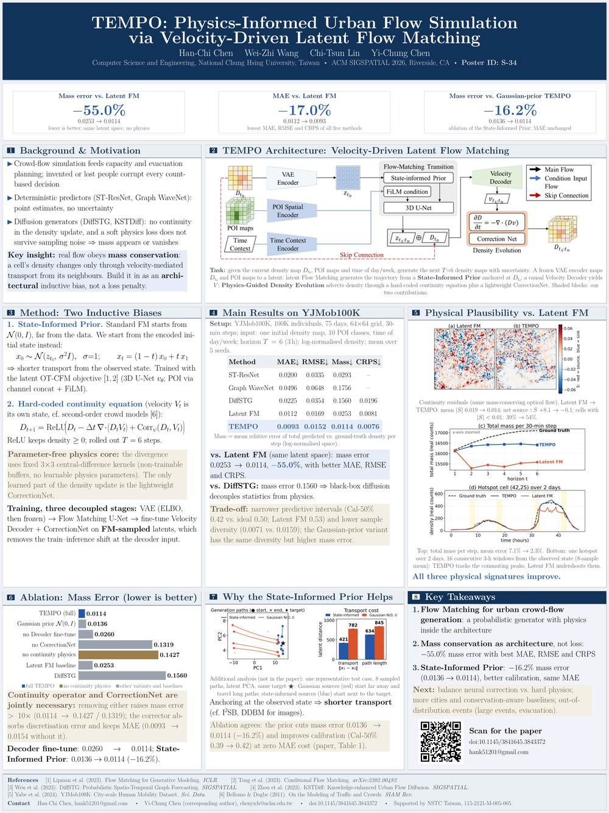

<div align="center">

# TEMPO: Physics-Informed Urban Flow Simulation via Velocity-Driven Latent Flow Matching

**Han-Chi Chen** · **Wei-Zhi Wang** · **Chi-Tsun Lin** · **Yi-Chung Chen**<sup>✉</sup>

Computer Science and Engineering, National Chung Hsing University, Taiwan

**ACM SIGSPATIAL 2026** · Riverside, CA · November 3–6, 2026 · **Poster S-34**

[](paper/TEMPO_SIGSPATIAL2026.pdf)
[](poster/TEMPO_poster_S-34.pdf)
[](video/TEMPO_lightning_talk.mp4)
[](https://doi.org/10.1145/3841645.3843372)

</div>

<p align="center">
  
</p>

<p align="center"><b>Same latent space, same decoder. Only TEMPO keeps the head count.</b><br>
One YJMob100K test window (test day 2, from 09:00), six 30-minute steps, mean of 20 samples. Within an hour the Latent FM baseline has lost 7–9% of the people on the map and never gets them back; TEMPO advects the observed density through a continuity equation and stays within 4% of the true head count (mean error over the six steps: 7.1% vs. 2.3%).</p>

## TL;DR

- **Problem.** Generative crowd-flow models, diffusion models in particular, routinely create or destroy people: nothing in their density update enforces continuity, and a soft physics loss does not survive sampling noise.
- **Idea.** Put the physics *inside* the generator. TEMPO decodes a latent trajectory into a velocity field and advects density through a hard-coded continuity equation, and it starts Flow Matching from the encoded observed state (a **State-Informed Prior**) instead of pure noise.
- **Result.** On YJMob100K (100K people, 75 days) TEMPO has the lowest MAE, RMSE and CRPS of five methods and cuts the mass-conservation error by **55%** against the same latent generator without physics.

<p align="center">
  
</p>

## How it works

<p align="center">
  
</p>

A frozen VAE encodes the observed density $D_{t_0}$ and the POI maps. Latent Flow Matching generates the future latent trajectory, a causal Velocity Decoder turns it into a velocity field $V_t$, and the density is advected forward by the physics step. Two inductive biases do the work:

**1. State-Informed Prior.** Standard Flow Matching starts from $\mathcal{N}(0, I)$, far from the data. TEMPO starts from the encoded observed state:

$$x_0 \sim \mathcal{N}(z_{t_0},\,\sigma^2 I),\quad \sigma = 1,\qquad x_t = (1-t)\,x_0 + t\,x_1$$

The transport from source to target is shorter and stays in the physically feasible region. Trained with the latent OT-CFM objective (3D U-Net; POI via channel concatenation and FiLM).

**2. Hard-coded continuity equation.** The velocity field is its own state, and the density update is the discrete continuity equation, not a loss term:

$$D_{t+1} = \mathrm{ReLU}\Big(D_t - \Delta t\,\nabla\cdot\big(D_t V_t\big) + \mathrm{Corr}_\psi(D_t, V_t)\Big)$$

The divergence uses fixed $3\times3$ central-difference kernels (non-trainable buffers, no learnable physics parameters). The only learned part of the density update is the lightweight CorrectionNet, which absorbs what the idealised equation misses. The operator is rolled out for $T = 6$ steps; ReLU keeps the density non-negative.

**Training in three decoupled stages:** VAE (ELBO, then frozen) → Flow Matching U-Net → fine-tune the Velocity Decoder and CorrectionNet on *FM-sampled* latents, which removes the train–inference shift at the decoder input.

## Results on YJMob100K

Mean over 5 seeds; metrics in log-normalised space; lower is better everywhere. Latent FM is the ablation twin of TEMPO: same VAE latent space, same Flow Matching generator, a plain decoder instead of the physics step.

| Method | MAE | RMSE | Mass error | CRPS |
|---|:-:|:-:|:-:|:-:|
| ST-ResNet | 0.0200 | 0.0335 | 0.0293 | – |
| Graph WaveNet | 0.0496 | 0.0648 | 0.1756 | – |
| DiffSTG | 0.0225 | 0.0354 | 0.1560 | 0.0196 |
| Latent FM (same latent space, no physics) | 0.0112 | 0.0169 | 0.0253 | 0.0081 |
| **TEMPO** | **0.0093** | **0.0152** | **0.0114** | **0.0076** |

**vs. Latent FM:** mass error 0.0253 → 0.0114 (**−55.0%**) with better MAE, RMSE and CRPS. **vs. DiffSTG:** mass error 0.1560, so black-box diffusion decouples the statistics from the physics.

### Physical plausibility

<p align="center">
  
</p>

Continuity residuals fitted with the same mass-conserving optical flow, Latent FM → TEMPO: mean |S| 0.019 → 0.014; net source ΣS +8.1 → −0.1; cells with |S| < 0.01: 39% → 54%. Latent FM is mottled with spurious sources and sinks; TEMPO is near zero.

| Total mass per step | One hotspot over two days |
|:-:|:-:|
|  |  |
| mean error 7.1% → 2.3% | 16 consecutive 3-h windows from the observed state (8-sample mean): TEMPO tracks the commuting peaks, Latent FM undershoots them |

**Trade-off.** The hard constraint narrows the set of admissible trajectories: TEMPO's 50% predictive intervals are narrower than nominal (Cal-50% 0.42 vs. the ideal 0.50; Latent FM 0.53) and sample diversity is lower (0.0071 vs. 0.0159). The Gaussian-prior variant has the same diversity but a higher mass error, so lower diversity alone does not explain the conservation gain.

<details>
<summary><b>Ablation: mass error (lower is better)</b></summary>

| Variant | Mass error |
|---|:-:|
| **TEMPO (full)** | **0.0114** |
| Gaussian prior $\mathcal{N}(0, I)$ instead of the State-Informed Prior | 0.0136 |
| no Decoder fine-tune on FM-sampled latents | 0.0260 |
| no CorrectionNet | 0.1319 |
| no continuity physics | 0.1427 |
| Latent FM baseline | 0.0253 |
| DiffSTG | 0.1560 |

Removing the continuity physics raises the mass error more than tenfold; removing the CorrectionNet instead gives 0.1319, so the two terms are jointly necessary. Skipping the decoder fine-tune more than doubles it.

</details>

### Why the prior helps

<p align="center">
  
</p>

Additional analysis, not in the paper: one representative test case, 8 sampled paths in latent PCA space, same target. Gaussian sources start far away and travel long paths; state-informed sources start next to the target, so the transport is shorter. The ablation agrees: the prior cuts the mass error 0.0136 → 0.0114 (**−16.2%**) and improves calibration (Cal-50% 0.39 → 0.42) at zero MAE cost.

## Poster and lightning talk

<p align="center">
  <a href="poster/TEMPO_poster_S-34.pdf"></a>
</p>

- **Poster S-34** (36 × 48 in): [PDF](poster/TEMPO_poster_S-34.pdf)
- **Lightning talk** (70 s, silent, 1080p): [MP4](video/TEMPO_lightning_talk.mp4)
- **Paper** (4 pages, open access): [PDF](paper/TEMPO_SIGSPATIAL2026.pdf) · [DOI 10.1145/3841645.3843372](https://doi.org/10.1145/3841645.3843372)

## FAQ

<details>
<summary><b>Isn't a hard-coded continuity equation too rigid for real crowds?</b></summary>

That is what the CorrectionNet is for: it compensates the gap between the idealised equation and reality. Removing it raises MAE from 0.0093 to 0.0154 and mass error from 0.0114 to 0.1319; removing the continuity term instead gives a mass error of 0.1427. The operator provides the structure, the corrector absorbs the discretisation error. Balancing the two terms is future work.

</details>

<details>
<summary><b>Why Flow Matching instead of diffusion?</b></summary>

Nearly straight transport paths, lower training variance and faster sampling than DDPM. More importantly for us, a data-dependent source distribution is natural in Flow Matching: we can start from the observed state, which is awkward in standard DDPM.

</details>

<details>
<summary><b>How is the mass error defined?</b></summary>

For each future step, the absolute relative error between the predicted and the ground-truth total density over the whole map, in log-normalised space, averaged over the 6 steps and over the test chunks (Eq. 4 in the paper). It measures agreement with the ground-truth total, which itself varies in time, so it is a mass-consistency metric rather than strict conservation.

</details>

<details>
<summary><b>Calibration and sample diversity are worse than the unconstrained baseline. Why?</b></summary>

The hard constraint narrows the set of admissible trajectories, so the samples spread less. Cal-50% is 0.42 vs. 0.53 for Latent FM; both are off the ideal 0.50 in opposite directions (TEMPO's intervals are narrower than nominal, Latent FM's wider). We see this as the fidelity–diversity trade-off of a hard physical constraint; rebalancing the CorrectionNet against the physics term is the obvious knob.

</details>

<details>
<summary><b>Does the Velocity Decoder leak future information?</b></summary>

No. It is a causal 3D residual network over the latent trajectory, so step $t$ only sees steps $\le t$.

</details>

<details>
<summary><b>Only one dataset?</b></summary>

Yes, YJMob100K with 5 seeds. Extending to other cities, to out-of-distribution events and to conservation-aware baselines is explicit future work.

</details>

## Citation

```bibtex
@inproceedings{chen2026tempo,
  title     = {{TEMPO}: Physics-Informed Urban Flow Simulation via Velocity-Driven Latent Flow Matching},
  author    = {Chen, Han-Chi and Wang, Wei-Zhi and Lin, Chi-Tsun and Chen, Yi-Chung},
  booktitle = {Proceedings of the 34th ACM International Conference on Advances in Geographic Information Systems (SIGSPATIAL '26)},
  year      = {2026},
  address   = {Riverside, CA, USA},
  publisher = {ACM},
  doi       = {10.1145/3841645.3843372}
}
```

## Code

The implementation is not public at the moment. If you are interested in the code or the trained checkpoints, please e-mail the first author.

## Contact

- Han-Chi Chen: hank51201@gmail.com
- Yi-Chung Chen (corresponding author): chenyich@nchu.edu.tw

## Acknowledgements

This work was supported by the National Science and Technology Council (NSTC), Taiwan, under grant 115-2121-M-005-005. The paper is published open access under the [Creative Commons Attribution 4.0 International License](https://creativecommons.org/licenses/by/4.0/).
