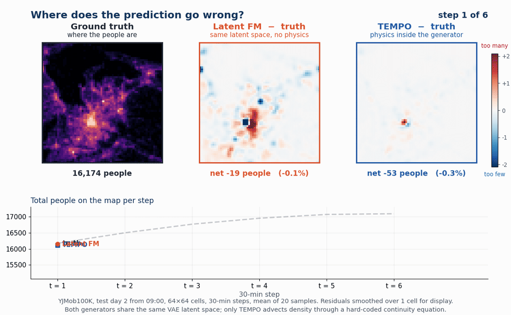
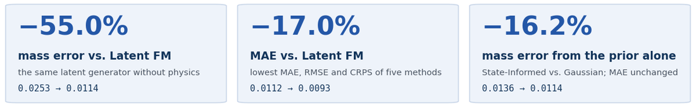
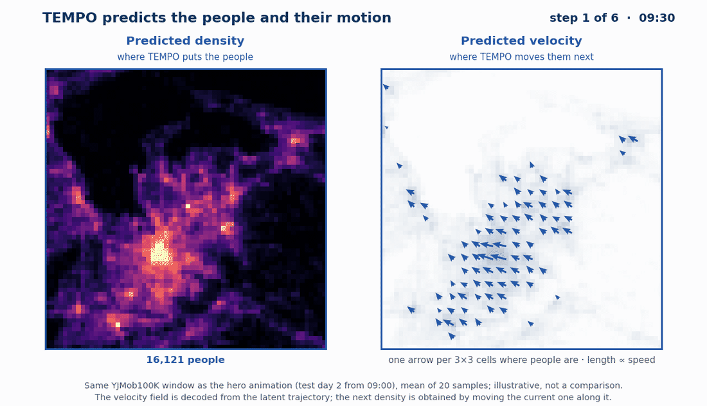
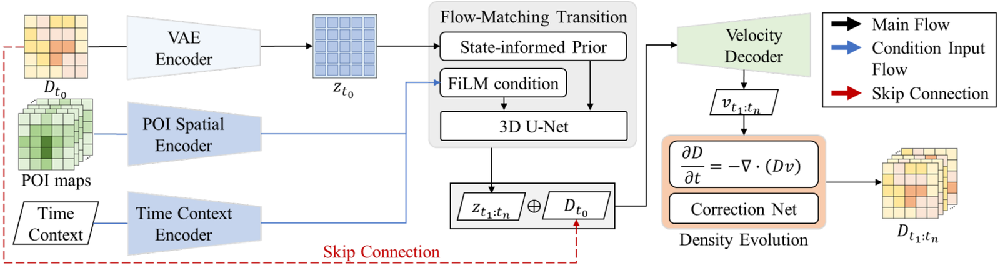
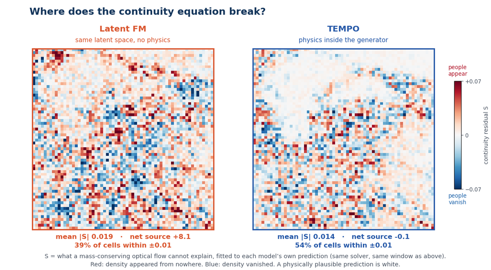
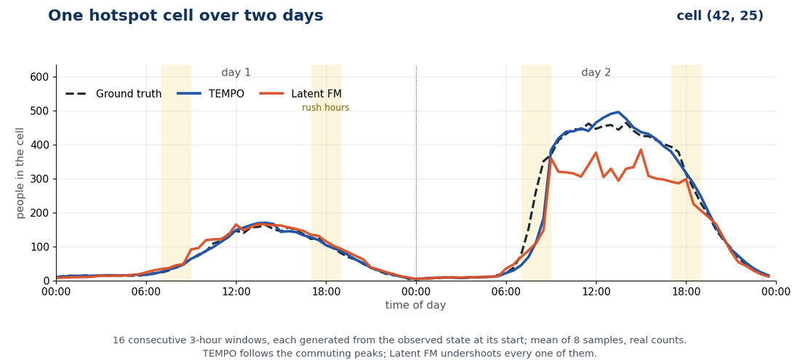
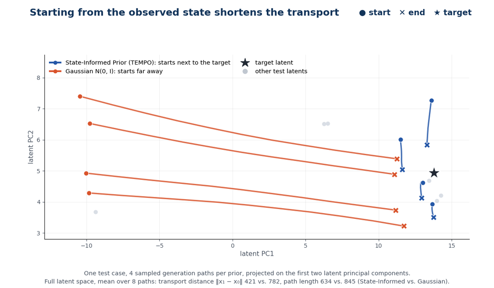

<div align="center">

# TEMPO

### Physics-Informed Urban Flow Simulation via Velocity-Driven Latent Flow Matching

**Han-Chi Chen** · **Wei-Zhi Wang** · **Chi-Tsun Lin** · **Yi-Chung Chen**<sup>✉</sup>
<br>Computer Science and Engineering, National Chung Hsing University, Taiwan

**ACM SIGSPATIAL 2026** · Riverside, CA · Poster S-34

[](paper/TEMPO_SIGSPATIAL2026.pdf)
[](poster/TEMPO_poster_S-34.pdf)
[](video/TEMPO_lightning_talk.mp4)

</div>

<p align="center">
  
</p>

<p align="center"><b>Same latent space, same generator. Only TEMPO keeps the head count.</b><br>
A generative crowd-flow model that cannot create or destroy people. One held-out YJMob100K window, six 30-minute steps: the Latent FM baseline loses 7–9% of the people within an hour, TEMPO stays within 4%.</p>

## In three sentences

- **Problem.** Generative crowd-flow models, diffusion models in particular, routinely create or destroy people: nothing in their density update enforces continuity, and a soft physics loss does not survive sampling noise.
- **Idea.** Put the physics *inside* the generator. TEMPO decodes a velocity field and advects the density through a hard-coded continuity equation, and it starts Flow Matching from the encoded observed state instead of pure noise.
- **Result.** On YJMob100K (100K people, 75 days) TEMPO has the lowest MAE, RMSE and CRPS of five methods and 55% less mass error than the same latent generator without physics.

<p align="center">
  <picture>
    <source media="(max-width: 700px)" srcset="assets/stats_stack.png">
    
  </picture>
</p>

## A guided tour

### 1 · TEMPO predicts motion, not just occupancy

<p align="center">
  
</p>

The generator never outputs the next density map directly. It outputs a **velocity field** for every step, and the density is moved along it. Where arrows converge, people accumulate; where they diverge, people leave. Nothing else can change the head count.

### 2 · The density update is a conservation law, not a loss term

<p align="center">
  
</p>

A frozen VAE encodes the observed density $D_{t_0}$ and the POI maps. Latent Flow Matching generates the future latent trajectory, a causal Velocity Decoder turns it into $V_t$, and the density is advected by the discrete continuity equation:

$$D_{t+1} = \mathrm{ReLU}\Big(D_t - \Delta t\,\nabla\cdot\big(D_t V_t\big) + \mathrm{Corr}_\psi(D_t, V_t)\Big)$$

The divergence is a fixed $3\times3$ central-difference stencil with no learnable physics parameters. The only learned part of the update is the lightweight CorrectionNet, which absorbs what the idealised equation misses. Remove the physics and the mass error grows more than tenfold; remove the CorrectionNet and it grows almost as much. The two are jointly necessary.

<details>
<summary><b>More on the architecture and training</b></summary>

- **State-Informed Prior.** Standard Flow Matching starts from $\mathcal{N}(0, I)$, far from the data. TEMPO starts from the encoded observed state, $x_0 \sim \mathcal{N}(z_{t_0}, \sigma^2 I)$ with $\sigma = 1$, and interpolates $x_t = (1-t)\,x_0 + t\,x_1$. Trained with the latent OT-CFM objective on a 3D U-Net; POI maps enter by channel concatenation and FiLM, time of day and week by FiLM.
- **Velocity Decoder.** A causal 3D residual network over the latent trajectory: step $t$ only sees steps $\le t$, so no future information leaks into the velocity.
- **Physics step.** The operator is rolled out for $T = 6$ steps of 30 minutes; ReLU keeps the density non-negative.
- **Training in three decoupled stages.** VAE (ELBO, then frozen) → Flow Matching U-Net → fine-tune the Velocity Decoder and CorrectionNet on *FM-sampled* latents, which removes the train–inference shift at the decoder input. Skipping this fine-tune more than doubles the mass error.

</details>

### 3 · Spurious sources and sinks disappear

<p align="center">
  
</p>

Fit the same mass-conserving optical flow to each model's prediction and map what it cannot explain. Latent FM is mottled with places where people appear from nowhere or vanish into it; TEMPO is close to white, with a net source of −0.1 against +8.1.

### 4 · The head count holds over two days, not just six steps

<p align="center">
  
</p>

One hotspot cell, sixteen consecutive 3-hour windows, each generated from the observed state at its start. Latent FM undershoots every commuting peak; TEMPO follows them.

### 5 · Starting from the observed state shortens the transport

<p align="center">
  
</p>

Standard Flow Matching has to carry every sample from pure noise all the way to the data. Starting from the encoded observed state, the transport is shorter (not straighter: straightness is actually lower, 0.66 vs. 0.93) and stays in the physically feasible region. On its own the prior cuts the mass error by 16.2% and improves calibration (Cal-50% 0.39 → 0.42) at zero MAE cost.

## The numbers

YJMob100K, mean over 5 seeds, log-normalised space, lower is better. Latent FM is the ablation twin of TEMPO: same VAE latent space, same Flow Matching generator, a plain decoder instead of the physics step.

| Method | MAE | RMSE | Mass error | CRPS |
|---|:-:|:-:|:-:|:-:|
| ST-ResNet | 0.0200 | 0.0335 | 0.0293 | – |
| Graph WaveNet | 0.0496 | 0.0648 | 0.1756 | – |
| DiffSTG | 0.0225 | 0.0354 | 0.1560 | 0.0196 |
| Latent FM | 0.0112 | 0.0169 | 0.0253 | 0.0081 |
| **TEMPO** | **0.0093** | **0.0152** | **0.0114** | **0.0076** |

<details>
<summary><b>Ablation: which part keeps the mass?</b></summary>

| Variant | Mass error |
|---|:-:|
| **TEMPO (full)** | **0.0114** |
| Gaussian prior instead of the State-Informed Prior | 0.0136 |
| no Decoder fine-tune on FM-sampled latents | 0.0260 |
| no CorrectionNet | 0.1319 |
| no continuity physics | 0.1427 |
| Latent FM baseline | 0.0253 |
| DiffSTG | 0.1560 |

</details>

<details>
<summary><b>How is the mass error defined?</b></summary>

For each future step, the absolute relative error between the predicted and the ground-truth total density over the whole map, averaged over the 6 steps and over the test windows (Eq. 4 in the paper). The ground-truth total itself varies in time, so this measures mass *consistency* with the data rather than strict conservation.

</details>

## What TEMPO does not do

- **It is less diverse than the unconstrained baseline.** The hard constraint narrows the set of admissible trajectories: 50% predictive intervals are narrower than nominal (Cal-50% 0.42 vs. the ideal 0.50; Latent FM 0.53) and sample diversity is lower (0.0071 vs. 0.0159). Rebalancing the CorrectionNet against the physics term is the obvious knob.
- **It is not strict conservation.** The continuity step moves people; the CorrectionNet can still add or remove some, which is what lets the model follow a ground-truth total that changes over time.
- **It is tested on one dataset.** YJMob100K with 5 seeds. Other cities, out-of-distribution events and conservation-aware baselines are future work.

## Materials

| | |
|---|---|
| **Paper** · 4 pages, open access (CC BY 4.0) | [PDF](paper/TEMPO_SIGSPATIAL2026.pdf) · [DOI 10.1145/3841645.3843372](https://doi.org/10.1145/3841645.3843372) (resolves once the proceedings are in the ACM Digital Library) |
| **Poster S-34** · 36 × 48 in | [PDF](poster/TEMPO_poster_S-34.pdf) |
| **Lightning talk** · 70 s, silent, 1080p | [MP4](video/TEMPO_lightning_talk.mp4) |
| **Code and checkpoints** | not public at the moment; e-mail the first author |
| **Contact** | Han-Chi Chen, hank51201@gmail.com · Yi-Chung Chen (corresponding author), chenyich@nchu.edu.tw |

```bibtex
@inproceedings{chen2026tempo,
  title     = {{TEMPO}: Physics-Informed Urban Flow Simulation via Velocity-Driven Latent Flow Matching},
  author    = {Chen, Han-Chi and Wang, Wei-Zhi and Lin, Chi-Tsun and Chen, Yi-Chung},
  booktitle = {Proceedings of the 34th ACM International Conference on Advances in Geographic Information Systems (SIGSPATIAL '26)},
  year      = {2026},
  address   = {Riverside, CA, USA},
  publisher = {ACM},
  doi       = {10.1145/3841645.3843372}
}
```

Supported by the National Science and Technology Council (NSTC), Taiwan, grant 115-2121-M-005-005.
